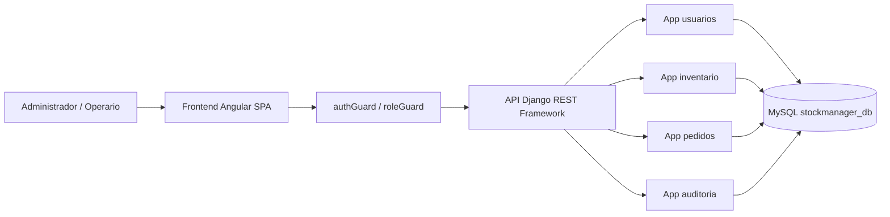
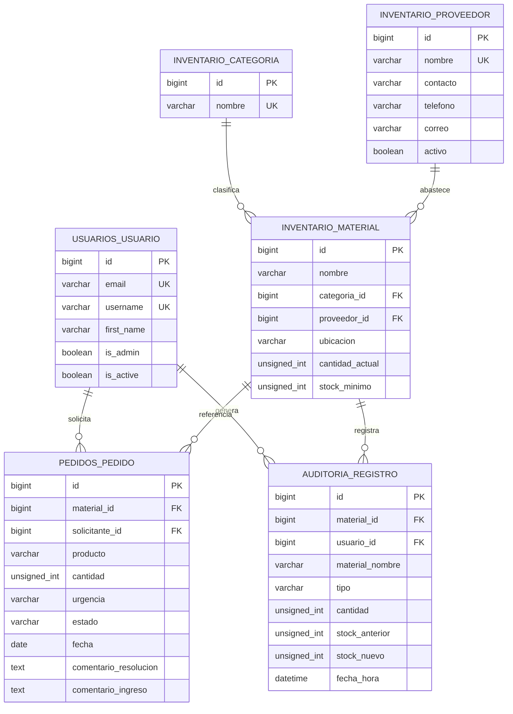
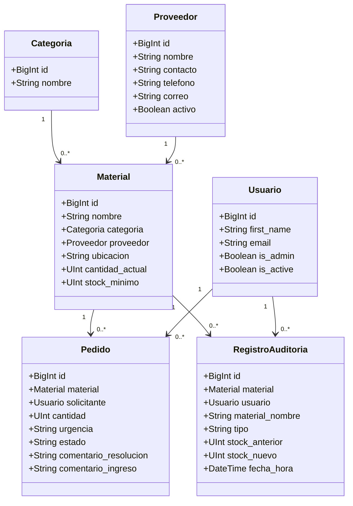
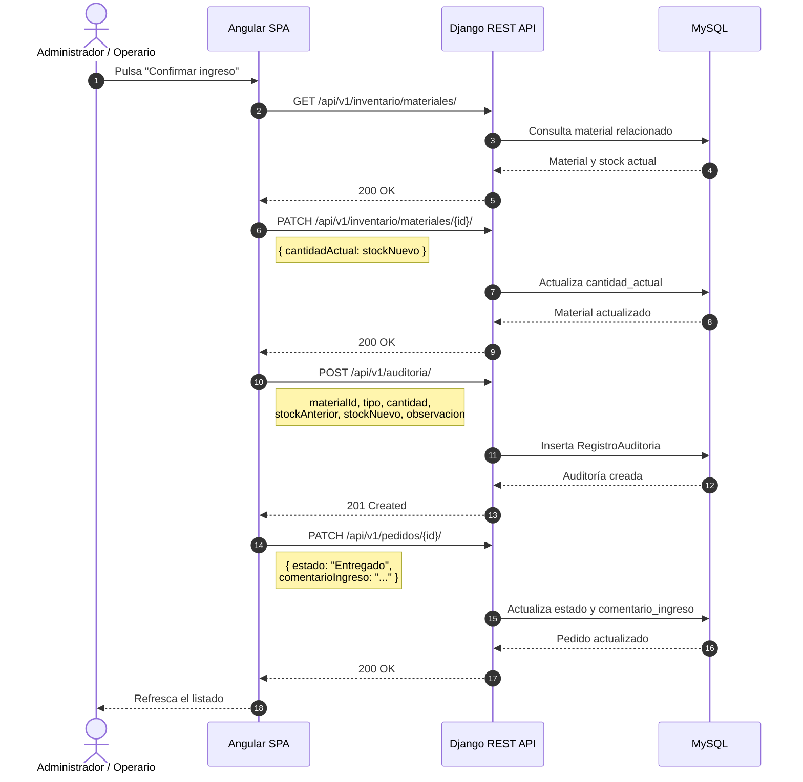

# Diagramas de arquitectura y diseño — StockManager

**Arquitectura:** Angular SPA + Django REST Framework + MySQL 8.4+
**Prefijo API:** `/api/v1/`
**Autenticación:** JWT Bearer
**Fuente de verdad del modelo:** `backend/*/models.py` y migraciones Django

## 1. Diagrama de componentes



### Responsabilidades modulares

- **`usuarios`:** login, refresh JWT, usuarios y cambio de contraseña.
- **`inventario`:** materiales, categorías, proveedores y stock.
- **`pedidos`:** solicitudes, estados y comentarios de resolución/ingreso.
- **`auditoria`:** historial de movimientos y snapshots históricos.

Todas las vistas funcionales propias heredan de `APIView`. La renovación JWT
utiliza `RefreshTokenView` de SimpleJWT mediante la clase adaptadora del módulo
`usuarios`.

## 2. Diagrama entidad-relación



Reglas:

- `Pedido.material`: `CASCADE`.
- `Pedido.solicitante`: `SET_NULL`.
- `RegistroAuditoria.material`: `SET_NULL`.
- `RegistroAuditoria.usuario`: `SET_NULL`.

## 3. Diagrama de clases del dominio



El modelo no declara métodos de dominio artificiales. Las operaciones CRUD,
las actualizaciones de estado y el registro de auditoría se ejecutan en
serializers, APIViews y servicios Angular.

## 4. Diagrama de secuencia: confirmar ingreso de pedido

El flujo real implementado para confirmar un pedido en estado `En Camino` es
coordinado por Angular. No existe un endpoint independiente
`/aprobar/` ni `/movimiento/`.



Los estados de pedido vigentes son:

```text
Pendiente → Aprobado → En Camino → Entregado
                         ↘ Cancelado
Pendiente/Aprobado ───────→ Cancelado
```

> El estado `Rechazado` no existe en el código actual. La cancelación se
> representa mediante `Cancelado`.
