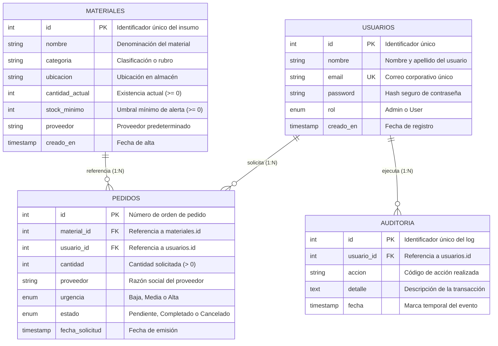
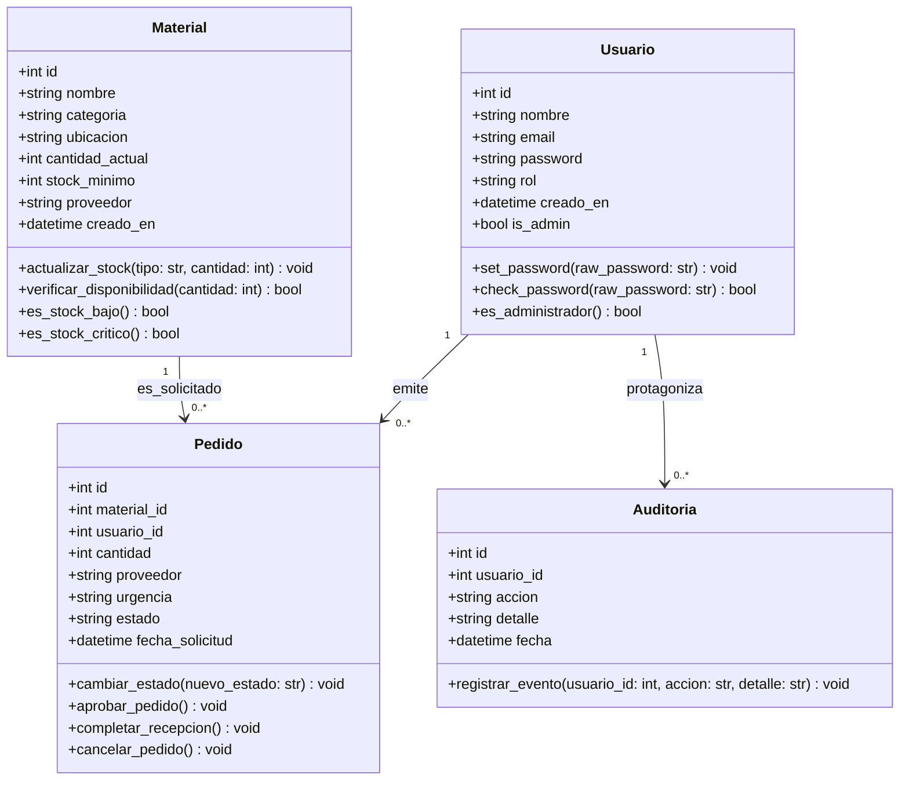
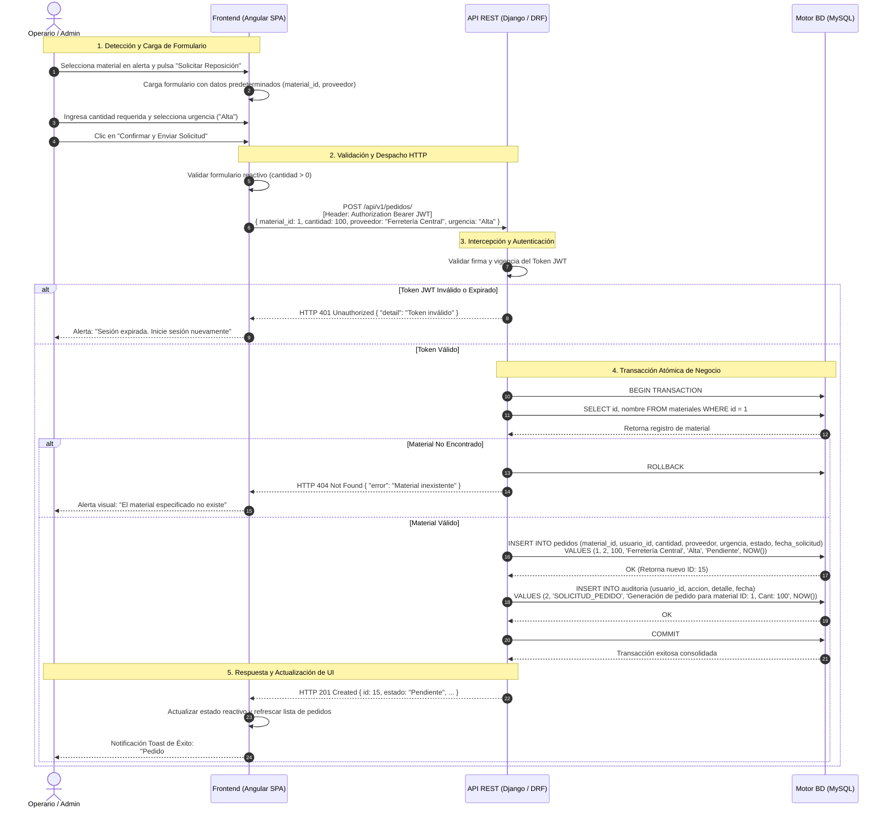

# Diagramas de Arquitectura y Diseño — StockManager

**Proyecto:** StockManager  
**Documento:** Diagramas de Especificación Técnica (Mermaid.js)  
**Versión:** 1.0.0  
**Fecha:** Octubre 2026  

---

## 1. Introducción

El presente documento complementa la documentación arquitectural y funcional de **StockManager**, proporcionando la representación visual estandarizada mediante diagramas renderizables con **Mermaid.js**. Se incluyen tres modelos fundamentales:

1. **Diagrama Entidad-Relación (DER):** Modelado físico de la base de datos relacional MySQL (`stockmanager_db`).
2. **Diagrama de Clases (UML):** Estructura del modelo de dominio orientado a objetos en Python / Django.
3. **Diagrama de Secuencia:** Flujo temporal y transaccional del caso de uso nuclear *"Generar Solicitud de Reposición"*.

---

## 2. Diagrama Entidad-Relación (DER)

Representa el esquema relacional normalizado implementado en `database/init_db.sql`. Se explicitan las entidades, atributos, claves primarias (`PK`), claves foráneas (`FK`), restricciones únicas (`UK`) y cardinalidades de cardinalidad 1 a N:

- Un **usuario** puede emitir de 0 a muchos **pedidos** (`1:N`).
- Un **usuario** puede generar de 0 a muchos registros de **auditoría** (`1:N`).
- Un **material** puede estar involucrado en 0 a muchos **pedidos** de reposición (`1:N`).

---

## 3. Diagrama de Clases del Dominio (UML)

Representa las entidades del modelo de datos y lógica de negocio en el backend (Python / Django ORM), detallando atributos tipados, modificadores de acceso y métodos de dominio para el control de inventario y pedidos:

### Descripción de Responsabilidades de Clases:
- **`Usuario`:** Encapsula la gestión de identidad, encriptación de credenciales y autorización RBAC (`Admin` / `Operario`).
- **`Material`:** Aplica invariantes de inventario (regla de no negatividad en stock), evalúa umbrales dinámicos de severidad y gestiona altas/bajas de existencias.
- **`Pedido`:** Implementa la máquina de estados de las solicitudes de reabastecimiento (Pendiente $\rightarrow$ Aprobado / Cancelado $\rightarrow$ Completado).
- **`Auditoria`:** Servicio transversal para registrar de forma inmutable todas las operaciones transaccionales realizadas en el sistema.

---

## 4. Diagrama de Secuencia: Generar Solicitud de Reposición

Describe la secuencia temporal y el intercambio de mensajes sincrónicos y asincrónicos entre los componentes del sistema para el caso de uso **CU-03 ("Generar Solicitud de Reposición de Materiales")**:

- **Actores y Participantes:**
  - **Operario / Admin:** Usuario final que detecta el stock bajo e inicia la solicitud.
  - **Frontend (Angular SPA):** Formulario reactivo con validaciones y manejo de token JWT.
  - **API REST (Django / DRF):** Controlador, serializadores, validaciones de negocio y transaccionalidad atómica.
  - **Base de Datos (MySQL):** Motor relacional con motor InnoDB y llaves foráneas.

---

## 5. Conclusiones y Trazabilidad

Los diagramas expuestos aseguran que tanto el equipo de desarrollo frontend, backend y administración de base de datos mantengan una referencia unívoca y rigurosa sobre:
1. **Esquema Relacional:** La exactitud de tipos, restricciones `CHECK`, valores por defecto y claves foráneas en MySQL.
2. **Arquitectura Orientada a Objetos:** El comportamiento encapsulado en los modelos de Django.
3. **Flujo de Ejecución:** La robustez transaccional requerida en la creación de órdenes de compra con auditoría vinculada.
